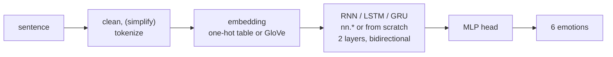
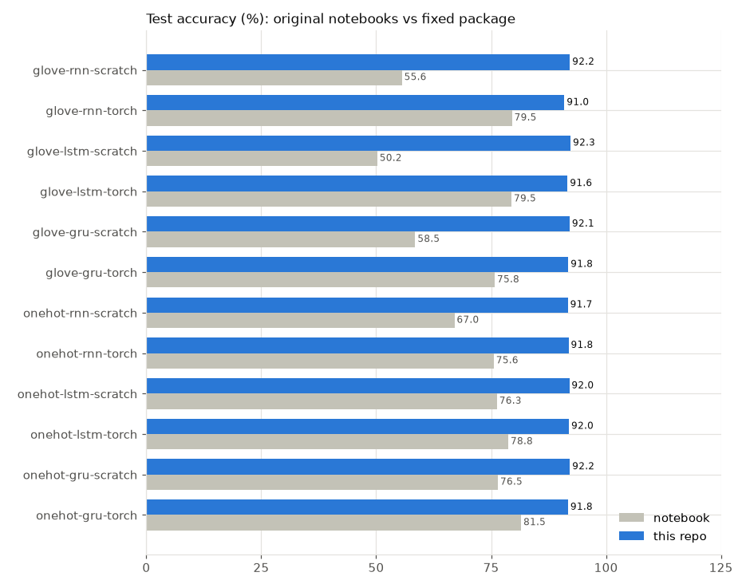
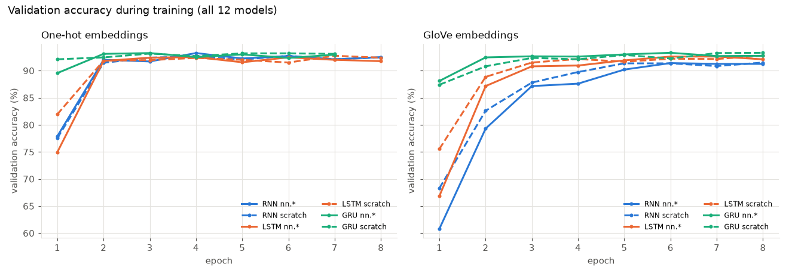
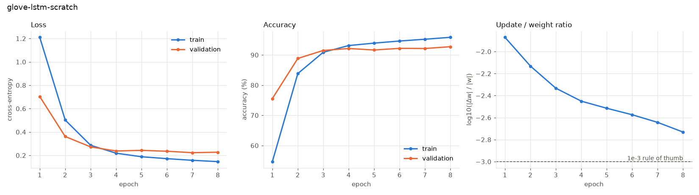
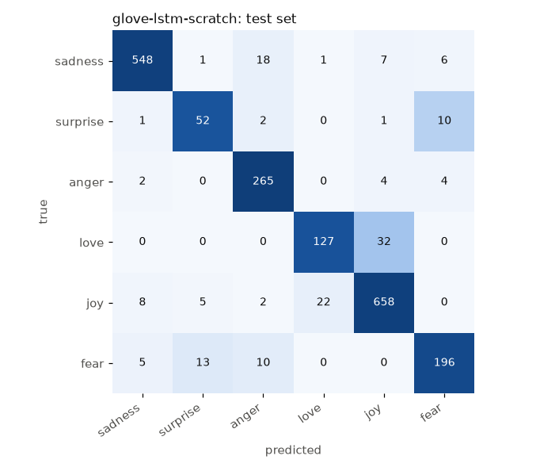
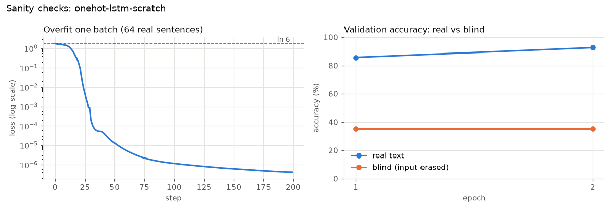

# nlp-text-classification

**Read a short English sentence, tell which of six emotions it carries.**
RNN, LSTM and GRU in PyTorch, each built twice (with `nn.LSTM` & co. and from
scratch), fed either learned one-hot embeddings or frozen GloVe vectors:
12 models, one codebase, one shared training recipe.

[](https://github.com/benisalla/nlp-text-classification/actions/workflows/tests.yml)
[](LICENSE)
[](pyproject.toml)
[](https://pytorch.org)
[](https://huggingface.co/datasets/dair-ai/emotion)

```
sadness | surprise | anger | love | joy | fear
```



## Results

All 12 models trained for up to 8 epochs on a CPU with one shared recipe,
early-stopped on validation accuracy, and the best checkpoint scored on the
full 2,000-sentence test set. Every model now lands at **91–92% test accuracy
(macro F1 0.87–0.88)**. The original notebooks ranged from 50% to 81.5%:



Validation accuracy per epoch. Solid lines are `nn.RNN/LSTM/GRU` and dashed
lines are our from-scratch cells; they behave the same, as the parity tests
predict. GloVe (frozen, raw text) starts slower than the learned one-hot table
(on lemmatised text) and catches up by epoch 5:



One model in detail (`glove-lstm-scratch`, the best one, 92.3%): the loss
falls on both splits, early stopping keeps the best validation epoch, and the
update/weight ratio stays near the healthy 1e-3 zone:





The remaining errors are the classes you would expect: `love` taken for `joy`,
`surprise` taken for `fear`.

| model | test acc | macro F1 | | model | test acc | macro F1 |
|---|---:|---:|---|---|---:|---:|
| `onehot-rnn-torch` | 91.85% | 0.879 | | `glove-rnn-torch` | 90.95% | 0.866 |
| `onehot-rnn-scratch` | 91.70% | 0.866 | | `glove-rnn-scratch` | 92.15% | 0.881 |
| `onehot-lstm-torch` | 91.95% | 0.871 | | `glove-lstm-torch` | 91.65% | 0.868 |
| `onehot-lstm-scratch` | 92.00% | 0.878 | | `glove-lstm-scratch` | **92.30%** | **0.883** |
| `onehot-gru-torch` | 91.75% | 0.877 | | `glove-gru-torch` | 91.80% | 0.878 |
| `onehot-gru-scratch` | 92.15% | **0.884** | | `glove-gru-scratch` | 92.10% | 0.878 |

Curves and confusion matrices for every model, and what the numbers mean:
[docs/results.md](docs/results.md).

### Sanity checks pass on the real data

Before trusting long runs: the loss at init is ln 6 (the model starts unsure),
the network memorises one batch of 64 real sentences, and it clearly beats a
"blind" copy whose input is erased:



### Try it

```
$ textcls-predict --checkpoint checkpoints/glove-lstm-scratch/best.pt "i didnt feel humiliated" ...
sadness   0.98  (anger 0.01, fear 0.00)  <- i didnt feel humiliated
love      0.99  (fear 0.00, anger 0.00)  <- i feel so loved and cared for by my family
surprise  0.97  (fear 0.01, anger 0.00)  <- i was shocked when i saw the final score
fear      0.92  (joy 0.03, anger 0.02)  <- i am terrified of what tomorrow will bring
anger     0.99  (fear 0.01, joy 0.00)  <- i am so furious that they lied to me again
surprise  0.88  (joy 0.10, fear 0.01)  <- i feel amazing today, everything went right
```

The last one is a real mistake (it should be joy). A likely reason: in the
training set "amazing" is labelled *surprise* 39 times out of 121 (10x the
3.6% base rate of surprise), and its close GloVe neighbour "amazed" is
*surprise* in 66 of 70 sentences.

## Quick start

```bash
# 1. install (Python >= 3.10)
python -m venv .venv && source .venv/bin/activate
pip install torch --index-url https://download.pytorch.org/whl/cpu   # or your CUDA build
pip install -e '.[dev]'

# 2. unit tests: CPU, offline, fake data (~40 s)
pytest

# 3. sanity checks on the real data (downloads the dataset)
python scripts/sanity_check.py --embedding onehot --cell lstm --impl scratch

# 4. train one model (~0.5-2 min per epoch on one CPU core)
textcls-train --embedding glove --cell gru --impl torch --epochs 8

# 5. use it
textcls-predict --checkpoint checkpoints/glove-gru-torch/best.pt "i feel so alone tonight"

# 6. (optional) train all 12 and regenerate docs/results.md
python scripts/run_all.py --epochs 8
```

On a machine that is busy with other jobs, add `--threads 1` (or
`OMP_NUM_THREADS=1`): small RNNs get *much slower* when PyTorch fights for cores.

## Documentation

| guide | what is inside |
|---|---|
| [docs/overfit.md](docs/overfit.md) | overfit test: all 12 models memorise one real batch |
| [docs/results.md](docs/results.md) | all 12 models: test accuracy, macro F1, curves, confusion matrices, sanity checks |
| [docs/training.md](docs/training.md) | install, data, every training flag, prediction from the CLI and from Python |
| [docs/architecture.md](docs/architecture.md) | preprocessing, embeddings, the cell equations, shapes, parameter counts |
| [docs/testing.md](docs/testing.md) | the unit tests and what each one proves; the neural-network sanity checks |
| [legacy/README.md](legacy/README.md) | the original notebooks and **the 13 things that were fixed** |

## Repository layout

```
src/textcls/          the package (read in this order)
  config.py           every hyperparameter: DataConfig, ModelConfig, TrainConfig
  data.py             download, cleaning, stop words / lemmas, dataset, padding collator
  tokenizer.py        WordTokenizer (one-hot vocabulary) and GloVe loading
  model.py            embeddings, RNN/LSTM/GRU cells from scratch, ScratchRNN, TextClassifier
  metrics.py          accuracy, macro precision / recall / F1, confusion matrix
  train.py            training loop, early stopping, checkpoints, `textcls-train`
  predict.py          Predictor class and `textcls-predict`
  plots.py            training curves, confusion matrix, comparison chart
scripts/
  run_all.py          train the 12 models, write docs/results.md and figures
  overfit_all.py      overfit one real batch with all 12 models (docs/overfit.md)
  sanity_check.py     init loss, overfit a batch, real-vs-blind, gradient flow (real data)
tests/                pytest suite (CPU only, offline)
docs/                 guides, results and images
legacy/               the two original Colab notebooks + what changed
```

## Dataset

[dair-ai/emotion](https://huggingface.co/datasets/dair-ai/emotion)
(Saravia et al., 2018): English Twitter messages labelled with six emotions,
16,000 train / 2,000 validation / 2,000 test. Downloaded automatically on first
run. It is imbalanced (joy 33.5%, surprise 3.6%), which is why macro F1 is
reported next to accuracy.

## What changed from the notebooks

The notebooks' ideas, names and settings are kept; the package fixes what
was wrong. Highlights (full list with tests in [legacy/README.md](legacy/README.md)):

* **The from-scratch "RNNs" were not recurrent.** They built one cell per
  position (20 different weight sets), so a word learned at position 3 meant
  nothing at position 7. Now one cell is shared across time, and the tests
  prove our cells give *exactly* the numbers of `nn.RNN` / `nn.LSTM` / `nn.GRU`.
* **Padding leaked into the prediction.** The classifier read the hidden state
  after up to 17 `<pad>` tokens. Now sequences are packed (or masked), and a
  test checks that extra padding changes nothing, for all 12 models.
* **The GRU equation was wrong**, and an operator-precedence slip in the GloVe
  RNN skipped the recurrent update entirely.
* **Evaluation was optimistic and noisy**: training stopped when validation
  accuracy crossed a hand-picked target, validation used 10–20 random batches,
  short test sentences were removed, and the last (not best) weights were tested.

## Status and next steps

- [x] Package, CLIs, unit tests (CI on every push), neural-network sanity checks, overfit test for all 12 models
- [x] 12 models trained on CPU with one shared recipe (results above)
- [ ] Class-weighted loss or oversampling for `surprise` / `love` (lowest F1)
- [ ] Attention pooling over all hidden states instead of the last state
- [ ] A small Transformer encoder as the 13th model

## License

[MIT](LICENSE)
