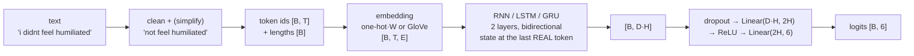

# Architecture

Every model is the same three-stage pipe. B = batch, T = tokens, E = embedding
size, H = hidden size, D = 2 if bidirectional else 1.



## 1. Text → ids (`data.py`, `tokenizer.py`)

| step | one-hot runs | GloVe runs |
|---|---|---|
| `clean_text` | lower-case, keep letters, digits, `.,!?;:` | same |
| `remove_less_freq_words` | drop words seen ≤ 3 times **in train** | off (GloVe knows rare words) |
| `simplify_text` | contractions → stop words → keep J/R/N/V/MD → lemma | off |
| tokenizer | `WordTokenizer(3100)`: `<pad>`=0, `<oov>`=1, 3,098 most frequent words | `GloveTokenizer`: GloVe words found in the corpus |
| max length | 20 tokens | 40 tokens |

`simplify_text` keeps negations on purpose (`not_stop_words`): "i didnt feel
humiliated" must not become "feel humiliated".

## 2. Embeddings (`model.py`)

**One-hot.** The notebook multiplied a one-hot vector by a `Linear(3100, 100)`.
A one-hot vector times a matrix selects one column of the weight (plus the
bias), so `OneHotEmbedding` indexes the weight directly. Same parameters,
same numbers (tested), no `[B, T, 3100]` tensor of zeros. It is a learned
embedding table trained from scratch.

**GloVe.** 100-d vectors trained on 6B tokens of Wikipedia + Gigaword, kept
**frozen**. Row 0 `<pad>` is zeros; row 1 `<oov>` is the mean GloVe vector.
Only the rows for words that occur in the dataset are kept (frozen vectors,
so no label information is used; it avoids a 400k × 100 table in every
checkpoint).

## 3. Recurrent encoder

### `impl="torch"`: `nn.RNN` / `nn.LSTM` / `nn.GRU`

The padded batch is packed with `pack_padded_sequence(lengths)`, so each
sentence stops at its own last token and `h_n` really is the sentence summary.
For a bidirectional network the backward direction starts at the last real
token, not on padding.

### `impl="scratch"`: our own cells

One step each, written to match PyTorch's equations exactly (the tests copy
PyTorch's weights into our cells and compare outputs):

```
RNN   h' = act(W_ih x + b_ih + W_hh h + b_hh)

LSTM  i, f, g, o = split(W_ih x + b_ih + W_hh h + b_hh)
      c' = σ(f) ⊙ c + σ(i) ⊙ tanh(g)
      h' = σ(o) ⊙ tanh(c')

GRU   r = σ(W_ir x + W_hr h + b_r)            reset
      z = σ(W_iz x + W_hz h + b_z)            update
      n = tanh(W_in x + b_in + r ⊙ (W_hn h + b_hn))
      h' = (1 − z) ⊙ n + z ⊙ h
```

`ScratchRNN` stacks them: **one cell per layer and direction, reused at every
time step** (that sharing is what makes it recurrent). Padding is handled with
a mask: at step t a sample keeps its old state if t ≥ its length.
For the backward direction each sentence is reversed inside its own length
(`[a b c PAD] → [c b a PAD]`), run forward, and reversed back.

Initialisation: input weights Xavier (torch impl) / PyTorch default (scratch),
recurrent weights orthogonal for the vanilla RNN (keeps ‖h‖ stable through
time), LSTM forget-gate bias = 1 (remember by default, Jozefowicz et al. 2015).

The notebooks' skip connection (`h + 0.5·x`) is available as `--residual`.

## 4. Head and loss

`dropout → Linear(D·H, 2H) → ReLU → Linear(2H, 6)`, as in the notebooks.
Loss: cross-entropy with label smoothing 0.01. Optimiser: AdamW
(β = 0.9, 0.994, weight decay 1e-4), gradient clipping at norm 5,
learning rate `max(lr · γ^epoch, min_lr)`.

## Parameter counts (defaults: E = 100, H = 128, 2 layers, bidirectional)

| model | one-hot (trainable) | GloVe (trainable, embedding frozen) |
|---|---:|---:|
| RNN  | 535,130 | 225,030 |
| LSTM | 1,008,218 | 698,118 |
| GRU  | 850,522 | 540,422 |

The `torch` and `scratch` versions of a model have exactly the same number of
parameters (same equations, same weight shapes).

Exact numbers per run are in [results.md](results.md).
