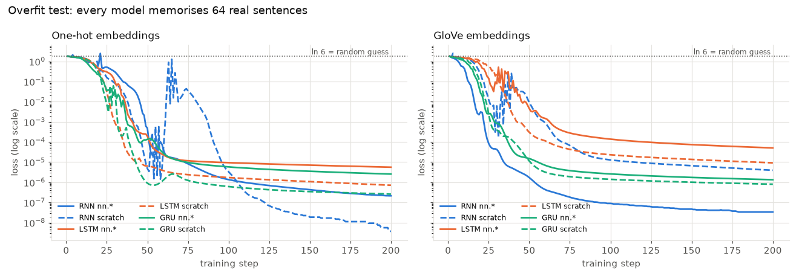

# Overfit test (all 12 models, real data)

`python scripts/overfit_all.py` trains each model on ONE batch of 64 real training
sentences (same batch for all, dropout off, Adam lr 3e-3). A model that works must
drive the loss from ln 6 = 1.79 to ~0 and reach 100% accuracy on that batch.

| model | loss at step 1 | loss at the end | accuracy on the batch | first step at 100% |
|---|---:|---:|---:|---:|
| `onehot-rnn-torch` | 1.809 | 0.00000 | 100% | 42 |
| `onehot-rnn-scratch` | 1.796 | 0.00000 | 100% | 36 |
| `onehot-lstm-torch` | 1.788 | 0.00001 | 100% | 30 |
| `onehot-lstm-scratch` | 1.795 | 0.00000 | 100% | 26 |
| `onehot-gru-torch` | 1.803 | 0.00000 | 100% | 22 |
| `onehot-gru-scratch` | 1.793 | 0.00000 | 100% | 21 |
| `glove-rnn-torch` | 1.809 | 0.00000 | 100% | 15 |
| `glove-rnn-scratch` | 1.782 | 0.00000 | 100% | 23 |
| `glove-lstm-torch` | 1.800 | 0.00005 | 100% | 26 |
| `glove-lstm-scratch` | 1.820 | 0.00001 | 100% | 34 |
| `glove-gru-torch` | 1.769 | 0.00000 | 100% | 17 |
| `glove-gru-scratch` | 1.797 | 0.00000 | 100% | 18 |

