# Results

All 12 models trained with the same recipe on CPU (`python scripts/run_all.py`),
early-stopped on validation accuracy, then the **best** checkpoint is scored on
the **full** test set (2,000 sentences). Macro F1 weighs the six classes
equally, so it exposes the rare classes (`surprise` is 3% of the data) that
accuracy hides.

| model | params (trainable) | epochs (best) | test acc | macro F1 | notebook acc | notebook F1 |
|---|---:|---:|---:|---:|---:|---:|
| `glove-rnn-scratch` | 225,030 | 8 (8) | **92.15%** | **0.881** | 55.60% | 0.353 |
| `glove-rnn-torch` | 225,030 | 8 (6) | **90.95%** | **0.866** | 79.55% | 0.644 |
| `glove-lstm-scratch` | 698,118 | 8 (8) | **92.30%** | **0.883** | 50.25% | 0.211 |
| `glove-lstm-torch` | 698,118 | 8 (6) | **91.65%** | **0.868** | 79.45% | 0.627 |
| `glove-gru-scratch` | 540,422 | 8 (7) | **92.10%** | **0.878** | 58.50% | 0.452 |
| `glove-gru-torch` | 540,422 | 8 (6) | **91.80%** | **0.878** | 75.80% | 0.629 |
| `onehot-rnn-scratch` | 535,130 | 8 (6) | **91.70%** | **0.866** | 67.02% | 0.365 |
| `onehot-rnn-torch` | 535,130 | 8 (4) | **91.85%** | **0.879** | 75.59% | 0.590 |
| `onehot-lstm-scratch` | 1,008,218 | 8 (7) | **92.00%** | **0.878** | 76.28% | 0.650 |
| `onehot-lstm-torch` | 1,008,218 | 8 (4) | **91.95%** | **0.871** | 78.75% | 0.589 |
| `onehot-gru-scratch` | 850,522 | 7 (3) | **92.15%** | **0.884** | 76.49% | 0.604 |
| `onehot-gru-torch` | 850,522 | 7 (3) | **91.75%** | **0.877** | 81.54% | 0.631 |

The notebook columns are **not** an apples-to-apples baseline: the notebooks
measured on a filtered test set (texts shorter than 3 tokens removed), stopped
training as soon as validation accuracy crossed a hand-picked target, and their
from-scratch models were not recurrent (one cell per position). See
[legacy/README.md](../legacy/README.md).


## What the numbers say

* **All 12 models land within ~1.5 points (91-92% accuracy, 0.87-0.88 macro F1).**
  On short, keyword-heavy sentences, a correctly wired RNN is already enough;
  the cell type and the embedding matter much less than getting padding,
  recurrence and evaluation right.
* **`nn.*` and from-scratch versions are equivalent**, as the parity tests
  predict (same equations, same parameter count). The small gaps come from
  different random initialisations, not from the implementation.
* **GloVe starts slower but needs no simplification**: frozen vectors plus raw
  text reach the same accuracy as a learned table on lemmatised text, with
  310k fewer trainable parameters (the frozen table is not trained).
* **The hard classes are the rare and the close ones**: `love` is confused
  with `joy`, `surprise` with `fear` (see the confusion matrices).


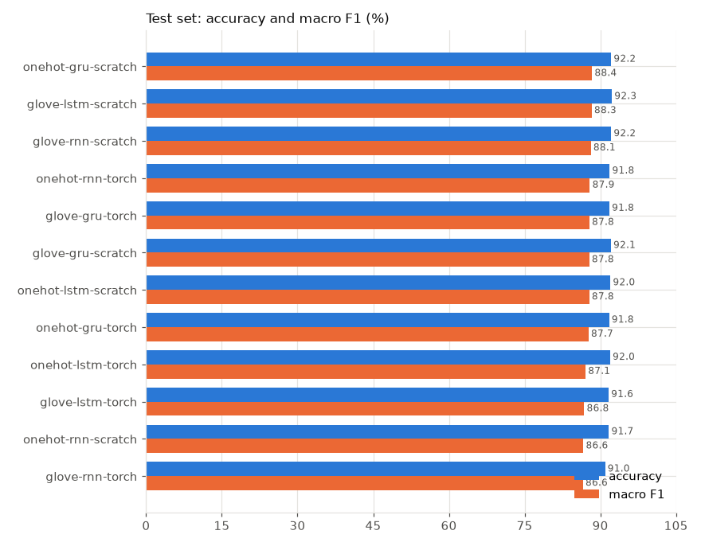

## Sanity checks

`python scripts/sanity_check.py --embedding onehot --cell lstm --impl scratch`
on the real data (see [testing.md](testing.md) for why each check matters):

```
[ok] 1. loss at init 1.786  (expected ~1.792)
[ok] 4. gradients reach every trainable tensor 
[ok] 2. overfit 64 sentences: loss 1.786 -> 0.0000, acc 100%
[ok] 3. val acc after 2 epochs: real 0.925 vs blind 0.352
ALL CHECKS PASSED -> docs/images/sanity-onehot-lstm-scratch.png
```


## Per model

Loss, accuracy and the log10 update/weight ratio per epoch (the ratio starts
near -1.9 and decays to about -2.7, close to the usual -3 rule of thumb, following the
learning-rate schedule), then the test confusion matrix of the best checkpoint.

### `glove-rnn-scratch`

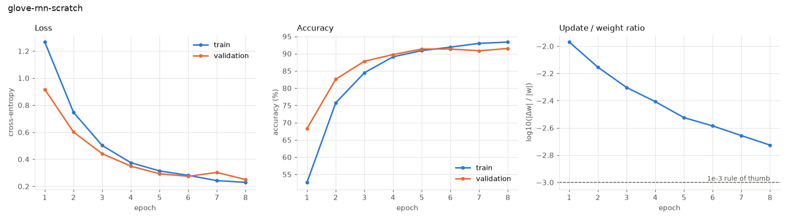


### `glove-rnn-torch`

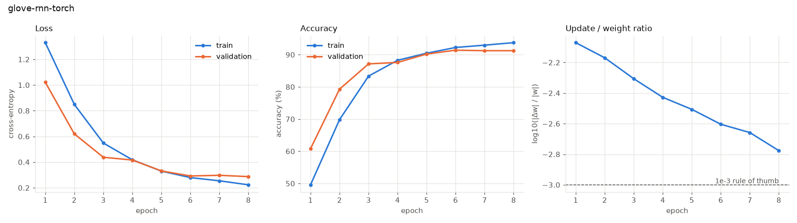


### `glove-lstm-scratch`


### `glove-lstm-torch`

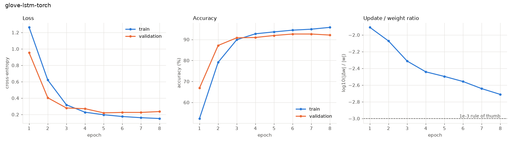


### `glove-gru-scratch`

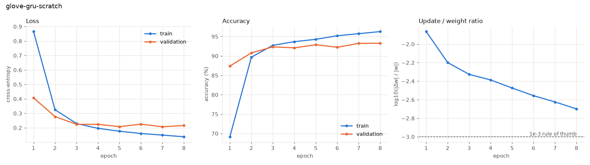


### `glove-gru-torch`

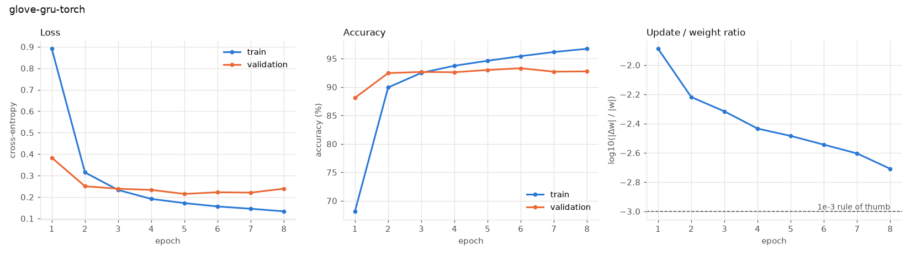

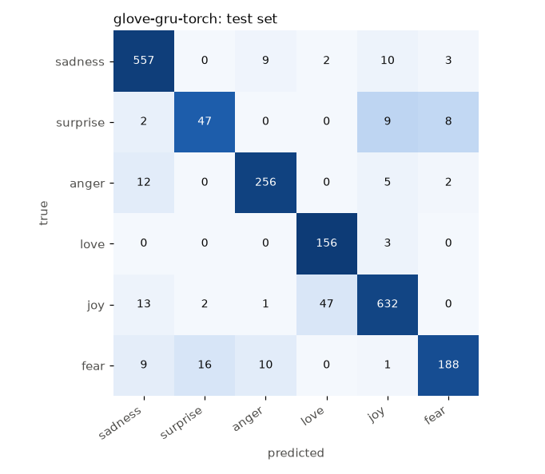

### `onehot-rnn-scratch`

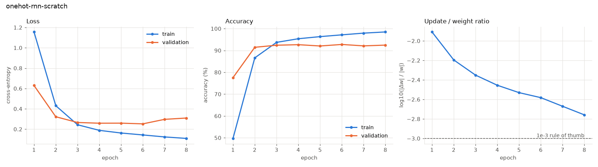


### `onehot-rnn-torch`

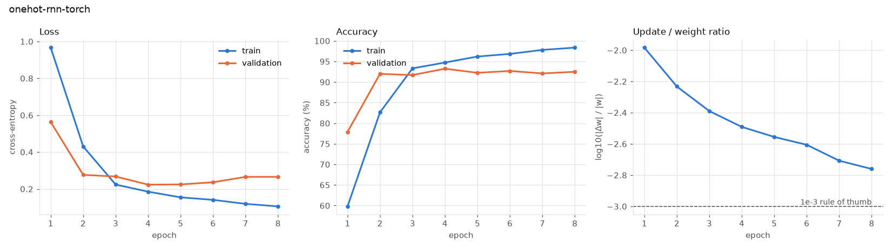

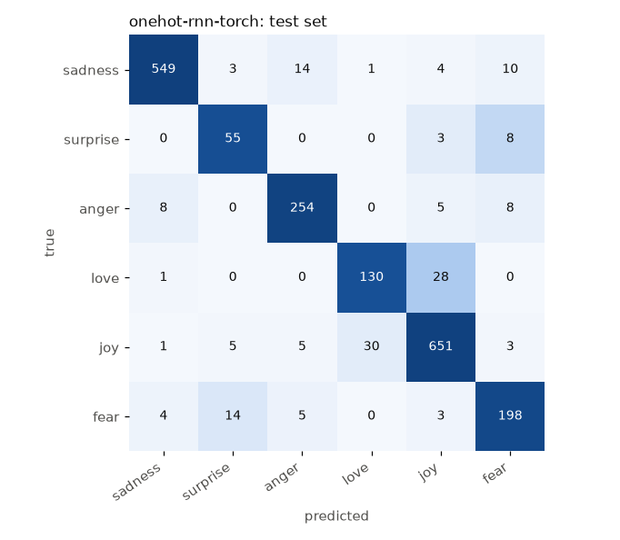

### `onehot-lstm-scratch`

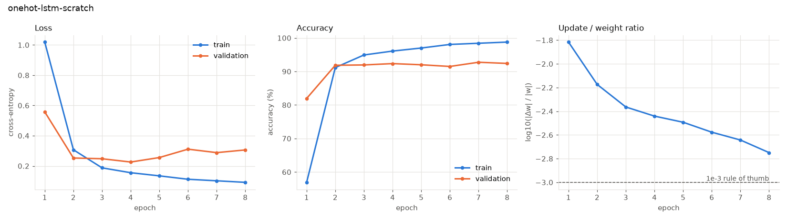


### `onehot-lstm-torch`

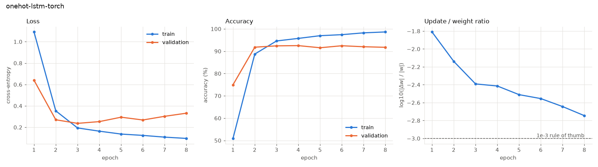


### `onehot-gru-scratch`

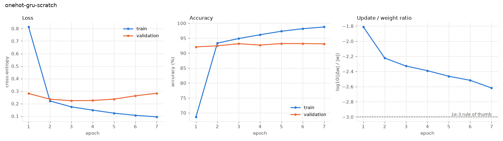


### `onehot-gru-torch`

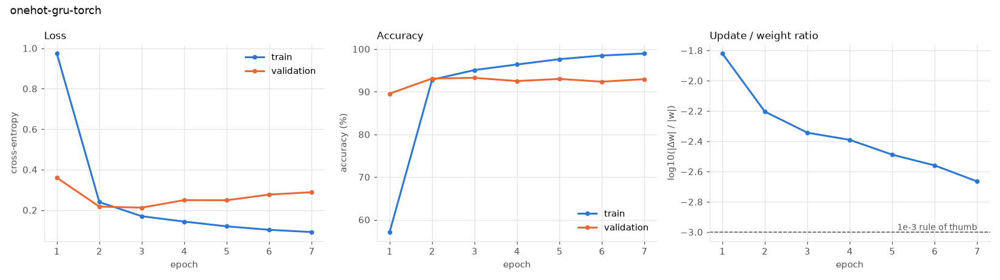

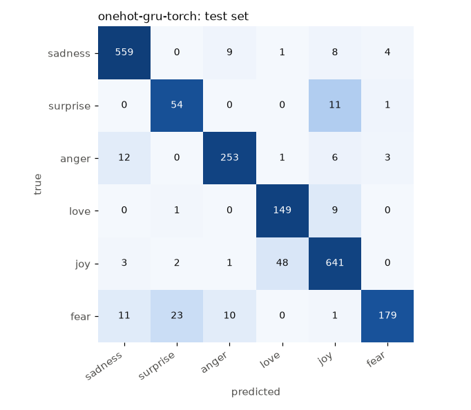

